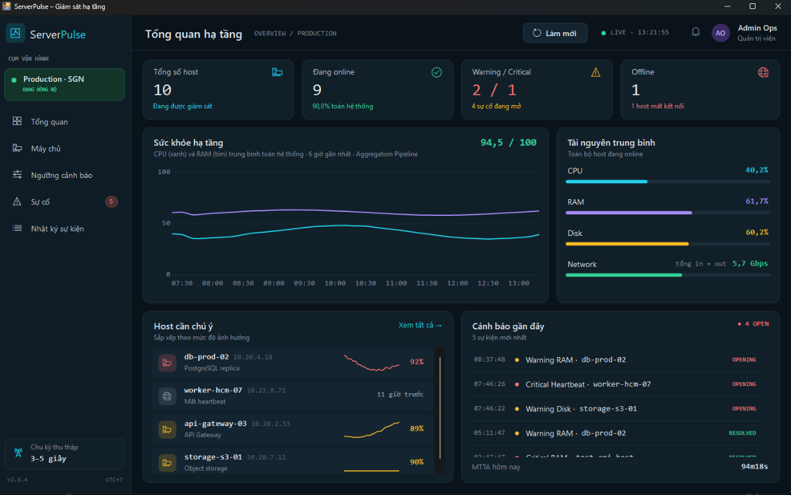
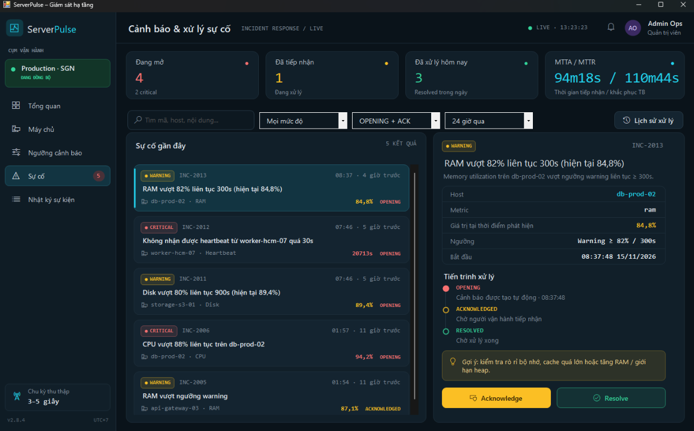

# ServerPulse

Ứng dụng desktop giám sát hiệu năng máy chủ, theo dõi cảnh báo và hỗ trợ xử lý sự cố. ServerPulse được xây dựng bằng C#/.NET Framework, sử dụng MongoDB để lưu trữ dữ liệu và cung cấp giao diện vận hành trên Windows.



*Dashboard tổng quan hạ tầng: trạng thái máy chủ, sức khỏe hệ thống, tài nguyên và cảnh báo gần đây.*

## Tổng quan

ServerPulse thu thập và hiển thị các chỉ số CPU, RAM, Disk, Network và heartbeat của máy chủ. Hệ thống có thể chạy với dữ liệu mô phỏng để trình diễn hoặc theo dõi máy đang chạy ứng dụng ở chế độ thực.

### Tính năng chính

- Dashboard tổng hợp trạng thái máy chủ, sức khỏe hạ tầng, mức sử dụng tài nguyên và cảnh báo gần đây.
- Quản lý máy chủ: tìm kiếm, lọc, phân trang, thêm/sửa/xóa và xuất danh sách CSV.
- Theo dõi lịch sử CPU, RAM, Disk và Network theo nhiều khoảng thời gian.
- Cấu hình ngưỡng cảnh báo toàn hệ thống hoặc theo từng máy chủ.
- Tự phát hiện cảnh báo và quản lý vòng đời sự cố: `OPENING` → `ACKNOWLEDGED` → `RESOLVED`.
- Ghi nhật ký sự kiện và hỗ trợ phân quyền Admin/Viewer.
- Thu thập metric định kỳ; Dashboard sử dụng MongoDB Aggregation Pipeline để tổng hợp dữ liệu theo thời gian.



*Màn hình sự cố: lọc cảnh báo, xem thông tin chi tiết và ghi nhận quá trình xử lý.*

## Công nghệ

| Thành phần | Công nghệ |
|---|---|
| Desktop UI | C#, Windows Forms |
| Nền tảng | .NET Framework 4.7.2 |
| API nội bộ | REST/JSON trên `HttpListener` |
| Cơ sở dữ liệu chính | MongoDB |
| Cache và tìm kiếm bổ trợ | Redis và Elasticsearch (tùy chọn) |
| Biểu đồ | `System.Windows.Forms.DataVisualization` |

## Kiến trúc

```text
Windows Forms UI ── HTTP/JSON ──> REST API ──> MongoDB
                                      ▲
                         Collector / Agent
```

Giao diện WinForms gọi REST API thay vì truy cập MongoDB trực tiếp. API và các dịch vụ nền xử lý xác thực, phân quyền, thu thập metric, đánh giá ngưỡng và ghi nhận sự kiện.

### Các collection MongoDB

| Collection | Dữ liệu |
|---|---|
| `servers` | Thông tin và cấu hình máy chủ |
| `metrics` | Các lần đo hiệu năng theo thời gian |
| `alert_rules` | Quy tắc ngưỡng cảnh báo |
| `alert_events` | Sự cố và trạng thái xử lý |
| `event_logs` | Nhật ký thao tác và sự kiện |
| `users` | Tài khoản và thông tin xác thực đã băm |

## Yêu cầu

- Windows 10/11.
- .NET Framework 4.7.2 Runtime; cần Developer Pack/targeting pack tương ứng để build.
- .NET SDK và Visual Studio 2022 hoặc VS Code để build/chạy từ mã nguồn.
- MongoDB Server đang chạy và có thể truy cập theo cấu hình ứng dụng.
- Redis và Elasticsearch không bắt buộc; ứng dụng vẫn có thể hoạt động nếu các dịch vụ tùy chọn này không được cấu hình hoặc không khả dụng.

## Bắt đầu nhanh

1. Khởi động MongoDB và xác nhận chuỗi kết nối trong [appsettings.json](Nhom3_NoSQL/Frontend/appsettings.json). Mặc định ứng dụng dùng `mongodb://localhost:27017` và database `Nhom3_NoSQL_Db`.
2. Mở PowerShell tại thư mục gốc của repository và khôi phục dependency:

   ```powershell
   dotnet restore .\Nhom3_NoSQL.sln
   ```

3. Chạy ứng dụng:

   ```powershell
   dotnet run --project .\Nhom3_NoSQL\Nhom3_NoSQL.csproj
   ```

   Hoặc mở [Nhom3_NoSQL.sln](Nhom3_NoSQL.sln) bằng Visual Studio 2022, chọn project `Nhom3_NoSQL` làm Startup Project và nhấn **F5**.

4. Cấu hình mặc định chạy ở chế độ `Demo`. Ứng dụng sẽ khởi tạo dữ liệu mẫu trong database được cấu hình và mô phỏng metric/cảnh báo. Nếu dùng database đã có dữ liệu, hãy kiểm tra cấu hình trước khi chạy.

Hướng dẫn cấu hình `Demo`/`Real`, tài khoản khởi tạo, backup/restore và thao tác ứng dụng được trình bày trong [tài liệu giao diện, API và hướng dẫn sử dụng](Nhom3_NoSQL/Docs/TaiLieu_GiaoDien_API_HuongDan.md).

## Chạy kiểm thử

Bộ kiểm thử nằm trong project `Nhom3_NoSQL.Tests`. Một số test cần API và MongoDB đang hoạt động:

```powershell
dotnet run --project .\Nhom3_NoSQL.Tests
```

Chỉ chạy test trên môi trường phát triển với database riêng; không trỏ bộ kiểm thử vào database production. Danh sách test case và hướng dẫn chi tiết nằm trong [Docs/TestCases.md](Nhom3_NoSQL/Docs/TestCases.md).

## Cấu hình và vận hành

- Cấu hình ứng dụng: [Nhom3_NoSQL/Frontend/appsettings.json](Nhom3_NoSQL/Frontend/appsettings.json).
- MongoDB mặc định: `localhost:27017`; database mặc định: `Nhom3_NoSQL_Db`.
- API nội bộ mặc định: `http://localhost:5080/api/v1/`.
- Log khởi động và runtime được ghi trong `%LOCALAPPDATA%\ServerPulse\logs`.
- Script backup/restore MongoDB và tự khởi động Windows nằm trong [Nhom3_NoSQL/Ops](Nhom3_NoSQL/Ops).
- Ảnh giao diện và kiểm thử nằm trong [Nhom3_NoSQL/Docs/screenshots](Nhom3_NoSQL/Docs/screenshots).

## Lưu ý bảo mật

- Tài khoản và dữ liệu ở chế độ `Demo` chỉ dành cho thử nghiệm; không dùng thông tin mặc định trong môi trường thật.
- Với database `Real` mới, cần cấu hình tài khoản Admin khởi tạo bằng các biến môi trường được mô tả trong tài liệu hướng dẫn. Không lưu mật khẩu hoặc chuỗi kết nối có thông tin xác thực vào source control.
- Mặc định API chỉ bind vào `localhost`. Khi cho máy khác kết nối, chỉ dùng HTTPS, cấp token Agent riêng cho từng host và giới hạn Windows Firewall trong LAN/VPN riêng. Không mở MongoDB ra mạng hoặc chuyển tiếp cổng API ra Internet.

## Tài liệu

- [Hướng dẫn giao diện, API, database và vận hành](Nhom3_NoSQL/Docs/TaiLieu_GiaoDien_API_HuongDan.md)
- [Danh sách test case](Nhom3_NoSQL/Docs/TestCases.md)
- [Mẫu CSV kiểm thử](Nhom3_NoSQL/Docs/csv-evidence/metrics-sample.csv)
